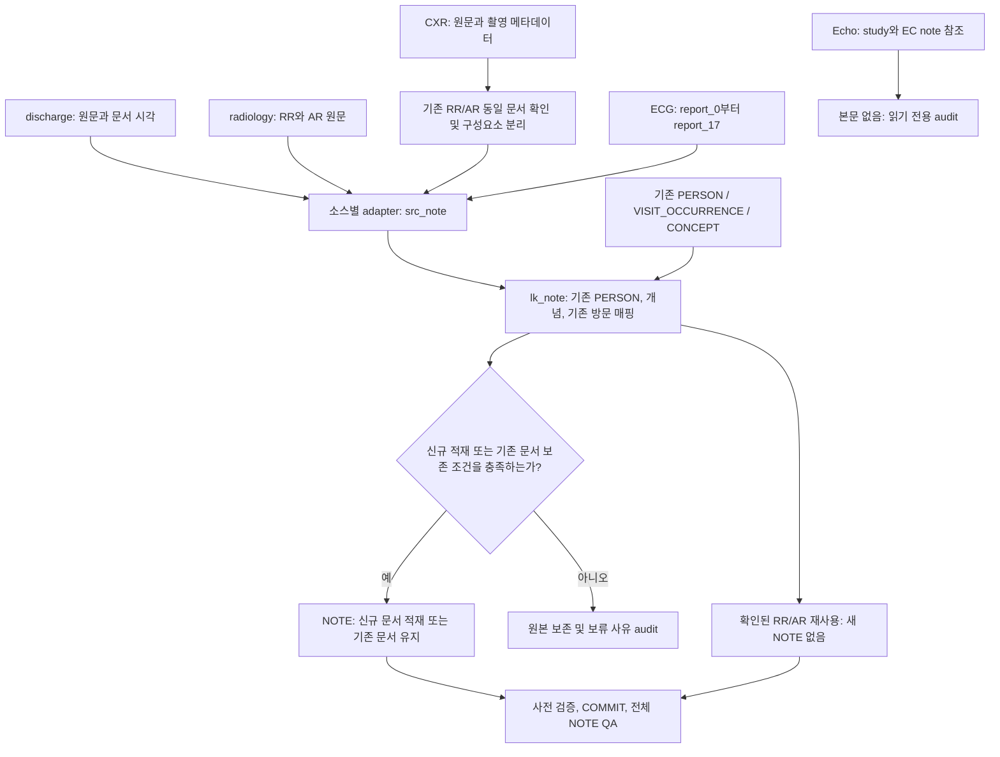
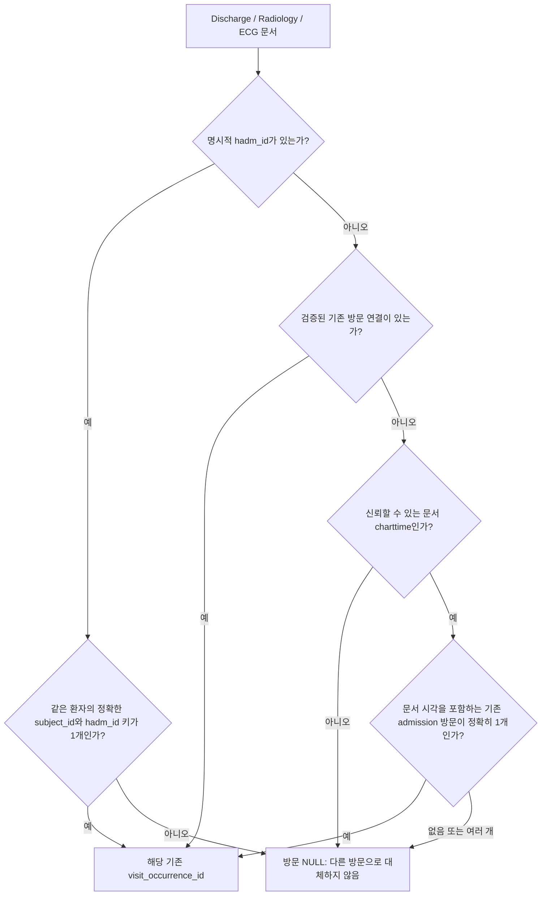
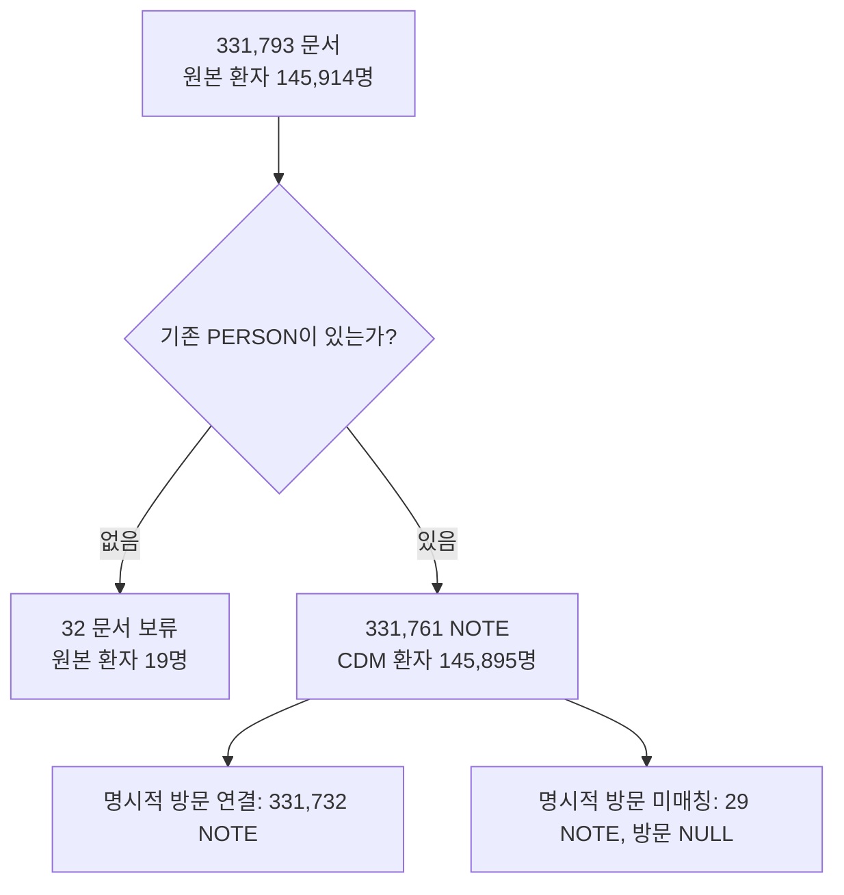
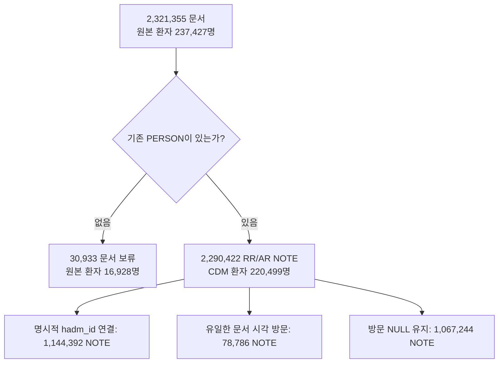
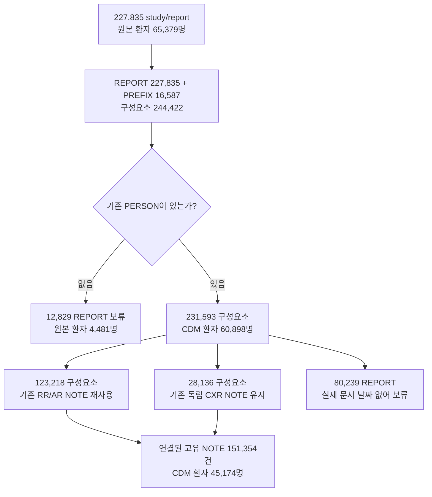
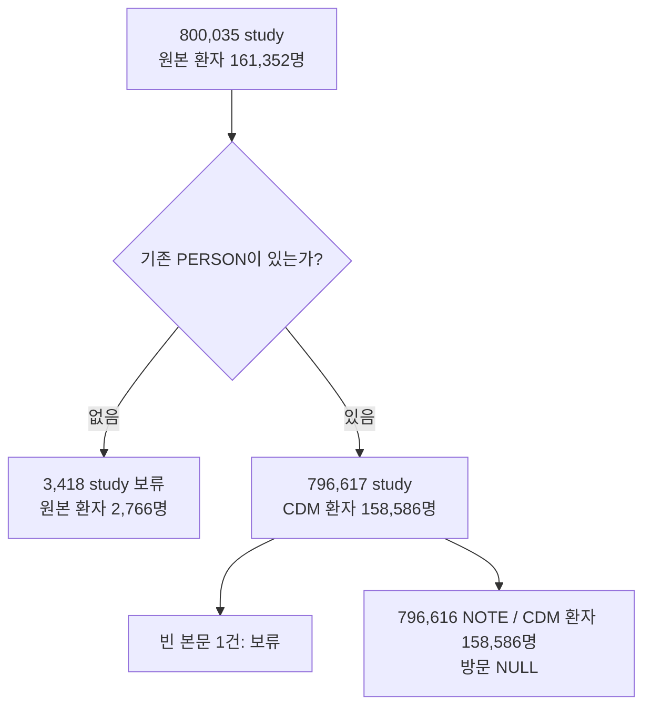
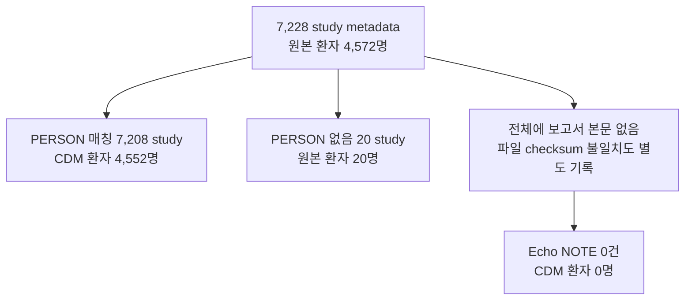

# MIMIC-IV NOTE ETL

Discharge, radiology, CXR, ECG, Echo 원본을 기존 OMOP CDM의 `NOTE`와 어떻게
연결하는지 설명한다. 원본별 adapter 이후에는 기존 OHDSI/MIMIC의
`src_* → lk_* → 컬럼별 INSERT SELECT → 검증` 순서를 따른다.

**현재 PostgreSQL 대상은 CDM 5.3.1의 `mimiciv.note`이다.** 기존 PERSON과
VISIT_OCCURRENCE를 사용하며, 이 ETL이 영구적으로 변경하는 임상 테이블은 NOTE뿐이다.
PROCEDURE_OCCURRENCE를 비롯한 다른 CDM 테이블에 행을 추가하거나 CDM을 확장하지 않는다.
BigQuery 구현의 대상은 기존 ETL dataset의 `cdm_note`이다.

## 목차

- [현재 적재 현황과 집계 기준](#snapshot)
- [전체 흐름과 공통 매핑](#common)
- [기존 방문 연결](#visits)
- [Discharge](#discharge)
- [Radiology](#radiology)
- [CXR](#cxr)
- [ECG 자동 판독문](#ecg)
- [Echo](#echo)
- [실행·검증·코드 위치](#execution)

<a id="snapshot"></a>

## 현재 적재 현황과 집계 기준

**2026-10-26 07:37 KST**에 로컬 PostgreSQL과 AWS RDS를 읽기 전용으로 집계했으며,
아래 건수와 고유 환자 수는 두 DB에서 일치했다. 로직 기준 commit은
[`02d89bc`](https://github.com/dr-you-group/MIMIC/commit/02d89bc3e4973026206298812be5205c46084398)이다.
수치는 공개 데이터셋의 소개 페이지가 아니라 **현재 원본 테이블과 실제 CDM** 기준이다.

| NOTE 구분 (`note_source_value`) | NOTE 건수 | 고유 CDM 환자 수 | 방문 연결 NOTE | 방문 NULL NOTE |
|---|---:|---:|---:|---:|
| Discharge: DS | 331,761 | 145,895 | 331,732 | 29 |
| Discharge addendum: AD | 0 | 0 | 0 | 0 |
| Radiology: RR | 2,265,110 | 220,498 | 1,213,584 | 1,051,526 |
| Radiology addendum: AR | 25,312 | 19,627 | 9,594 | 15,718 |
| CXR | 3,360 | 2,605 | 0 | 3,360 |
| CXR_SUPPLEMENT | 16,330 | 11,655 | 0 | 16,330 |
| CXR_VARIANT | 8,446 | 6,356 | 0 | 8,446 |
| ECG_MACHINE | 796,616 | 158,586 | 0 | 796,616 |
| Echo | 0 | 0 | 0 | 0 |
| **전체 NOTE / 환자 합집합** | **3,446,935** | **238,334** | **1,554,910** | **1,892,025** |

- **NOTE 건수**는 `COUNT(*)`, **고유 CDM 환자 수**는 `COUNT(DISTINCT person_id)`이다.
  환자는 여러 문서 유형·분기에 나타나므로 행별 환자 수를 더하면 안 된다.
  방문 연결 환자는 162,783명, 방문 NULL 문서가 있는 환자는 216,913명이며 두 집합도 겹친다.
- 아래 흐름 표의 **원본 환자**는 `COUNT(DISTINCT subject_id)`이다.
  `MISSING_PERSON`의 원본 환자에게는 대응하는 CDM PERSON이 없으므로 CDM 환자 수는 0이다.
- CXR은 **study**, **REPORT/PREFIX 구성요소**, **최종 NOTE**를 구분한다.
  기존 RR/AR 재사용은 새 NOTE를 만들지 않으며 위 RR/AR 건수에 이미 포함된다.
- Echo study 목록은 보고서 본문이 아니다. Echo의 7,228 study를 7,228 NOTE로 세지 않는다.
- 위 표는 **누적 적재 상태**이다. 최근 실행은 새 NOTE 0건, 기존 radiology NOTE의
  NULL 방문 연결 보완 78,786건이었다. 상세 실행 증거는
  [검증 보고서](docs/note_validation_20261026.md)에 있다.

<a id="common"></a>

## 전체 흐름과 공통 매핑



### NOTE 컬럼 매핑

| NOTE 컬럼 | 구현 규칙 |
|---|---|
| `note_id` | dataset, source table, 원본 문서 ID를 결합한 SHA-256의 앞 15 hex 자리(60 bit)를 정수로 변환. 중복·충돌 검증. CXR 동일 문서 재사용 시 기존 RR/AR ID 사용 |
| `person_id` | 기존 `person.person_source_value = subject_id::text`로 매핑 |
| `note_date` | 원본 문서 `charttime::date`. ECG는 제공된 `ecg_time`의 날짜. CXR의 기존 날짜 예외는 아래에 별도 명시 |
| `note_datetime` | 원본 `charttime`. ECG는 `ecg_time`. 날짜를 모르는 새 CXR 문서는 적재 보류 |
| `note_type_concept_id` | `32817` (EHR) |
| `note_class_concept_id` | 설치된 vocabulary에서 유효한 표준 LOINC, `domain_id = 'Note'`인 concept 조회 |
| `note_title` | 문서 유형별 제목. ECG는 `ECG machine interpretation`으로 자동 판독임을 구분 |
| `note_text` | 원문 그대로. CXR 구성요소는 해당 원문 부분 그대로, ECG는 순서대로 결합한 18개 report 슬롯 |
| `encoding_concept_id` | `32678` (UTF-8) |
| `language_concept_id` | `4180186` (English) |
| `provider_id` | 새 행은 NULL. 검증되지 않은 작성자를 생성하거나 추정하지 않음 |
| `visit_occurrence_id` | 기존 방문만 연결. 아래 방문 규칙 적용 |
| `visit_detail_id` | 새 행은 NULL. 기존 행의 검증된 값은 유지 |
| `note_source_value` | DS, AD, RR, AR, CXR, CXR_SUPPLEMENT, CXR_VARIANT, ECG_MACHINE |

| 문서 분류 | LOINC 코드 |
|---|---|
| DS / AD | `18842-5` |
| RR / AR / CXR 계열 | `68604-8` |
| ECG_MACHINE | `75425-9` |

개념 ID를 임의로 추가하지 않는다. 상수 개념과 문서 분류의 유효성을 설치된 vocabulary에서
검증하며, 필요한 매핑이 없으면 해당 source transaction을 중단한다.

원본 문서의 안정적인 식별 키는 다음과 같다. 버전은 provenance이며 ID 입력에는 넣지 않는다.

```text
Discharge: mimic-iv-note|discharge|<source_note_id>
Radiology: mimic-iv-note|radiology|<source_note_id>
CXR:       mimic-cxr|cxr|<subject_id>-CXR-<study_id>
CXR prefix: 위 CXR source_note_id에 -PREFIX 추가
ECG:       mimic-iv-ecg|ecg_machine|<subject_id>-ECG_MACHINE-<study_id>
```

기존 NOTE의 ID, 본문, 날짜, 제목, 개념 등은 덮어쓰지 않는다. 허용되는 기존 행 변경은
**NULL `visit_occurrence_id`를 검증된 기존 방문으로 채우는 것**뿐이다.
원본 변경에 따른 불일치는 자동 수정·삭제 대신 검증 실패로 처리한다.

`discharge_detail`, `radiology_detail`, `storetime`, `study_id` 등 NOTE에 직접 대응하지
않는 정보는 원본에 보존한다. 문서·study 연결과 `storetime` 등 추적 필드는 외부 audit에도
남긴다. 1:N detail을 NOTE에 직접 JOIN하여 문서를 늘리지 않는다.
`study_id`를 `note_source_value`나 본문에 끼워 넣지 않으며,
현재 범위에서 study/image/waveform 연결은 원본과 외부 source-to-NOTE audit를 사용한다.
작업 테이블은 임시 테이블이고, 기존 영구 확장 테이블은 현재 ETL의 의존성이 아니다.

<a id="visits"></a>

## 기존 방문 연결



1. 명시적 `hadm_id`가 있으면 **같은 person**이며
   `visit_source_value = subject_id::text || '|' || hadm_id::text`인 방문만 사용한다.
   문서 작성이 재원 기간 밖이어도 원본의 명시적 연결을 따른다. 해당 방문이 없으면
   NULL로 남기며 시간 기반 fallback을 적용하지 않는다.
2. `hadm_id`가 없으면 검증된 기존 연결을 유지한다. 새 연결은 실제 문서
   `charttime`이 `visit_start_datetime`부터 `visit_end_datetime` 사이에 있고
   후보가 정확히 하나일 때만 허용한다. 경계 시각은 포함한다.
3. 시간 기반 후보는 `visit_source_value`의 두 번째 항목이 **숫자 hadm_id**인
   admission 유래 방문이다. `subject_id|YYYY-MM-DD` 형태의 날짜 기반 방문은 제외한다.
   방문 concept 9201에만 제한하지 않으며, 조건을 충족하는 응급·관찰 방문 등도 대상이다.
4. 가까운 방문을 고르거나 기간을 확장하지 않는다. 후보가 없거나 여러 개여도
   문서 자체가 유효하면 NOTE를 보존하고 방문만 NULL로 둔다.
5. **CXR은 별도 경로**이다. 확인된 동일 RR/AR NOTE를 재사용하면 그 NOTE의 실제 날짜와
   방문 연결을 그대로 사용한다. 독립 CXR의 촬영 시각과 ECG의 동기화되지 않은 장비 시각은
   방문 추론에 사용하지 않는다.

시간 기반 연결은 문서가 속한 방문에 대한 추론이다. 영상·파형 study의 encounter를
별도로 입증한 것은 아니다. AR 역시 자신의 `hadm_id`와 `charttime`을 사용하며,
부모 RR의 방문을 자동으로 상속하지 않는다.

<a id="discharge"></a>

## Discharge

원본 `mimiciv_note.discharge`의 `note_id`, `subject_id`, `hadm_id`, `note_type`,
`charttime`, `text`를 사용한다. 원본 문서 한 건이 DS 또는 AD NOTE 한 건에 대응한다.
`discharge_detail`은 메타데이터로 보존하며 본문과 1:N JOIN하지 않는다.



| 흐름 단계 | 문서 / NOTE 건수 | 고유 원본 환자 수 | 고유 CDM 환자 수 | 결과 |
|---|---:|---:|---:|---|
| 원본 discharge | 331,793 | 145,914 | 145,895 | 현재 원본은 모두 DS |
| → PERSON 없음 | 32 | 19 | 0 | `MISSING_PERSON`, 원본 보존 |
| → PERSON 매칭 / 최종 NOTE | 331,761 | 145,895 | 145,895 | 본문·날짜 보존 |
| 최종 NOTE → 방문 연결 | 331,732 | 145,872 | 145,872 | `EXPLICIT_HADM` |
| 최종 NOTE → 방문 NULL | 29 | 29 | 29 | `UNMATCHED_EXPLICIT_HADM` |

AD 매핑은 구현되어 있지만 현재 원본에 AD가 0건이므로 CDM에도 0건이다.
방문 미매칭 29건은 NOTE 적재 손실이 아니다.

<a id="radiology"></a>

## Radiology

원본 `mimiciv_note.radiology`의 RR과 AR을 각각 독립 문서로 적재한다.
원문을 합치거나 addendum을 삭제하지 않는다. `radiology_detail`의 부모·추가기록 연결은
CXR 중복 확인에 사용하지만, 일반 radiology NOTE 건수를 늘리는 JOIN은 하지 않는다.



| 흐름 단계 | 문서 / NOTE 건수 | 고유 원본 환자 수 | 고유 CDM 환자 수 |
|---|---:|---:|---:|
| 원본 radiology (RR + AR) | 2,321,355 | 237,427 | 220,499 |
| → PERSON 없음 | 30,933 | 16,928 | 0 |
| → PERSON 매칭 / 최종 NOTE | 2,290,422 | 220,499 | 220,499 |
| 최종 NOTE → 방문 연결 | 1,223,178 | 146,769 | 146,769 |
| 최종 NOTE → 방문 NULL | 1,067,244 | 164,382 | 164,382 |

다음 분기는 **PERSON 매칭 후 실제 NOTE가 된 2,290,422건**을 분모로 한다.
각 NOTE는 한 분기에만 속하지만 환자는 여러 분기에 속할 수 있다.

| 방문 결정 | NOTE 건수 | 고유 CDM 환자 수 | 처리 |
|---|---:|---:|---|
| `EXPLICIT_HADM` | 1,144,392 | 142,473 | 명시적 기존 방문 연결 |
| `UNIQUE_ADMISSION_INTERVAL` | 78,786 | 28,530 | 기존 NULL 방문 보완 |
| `UNMATCHED_EXPLICIT_HADM` | 251 | 101 | 방문 NULL, 시간 fallback 없음 |
| `AMBIGUOUS_ADMISSION_INTERVAL` | 114 | 84 | 후보 중 임의 선택 없이 NULL |
| `NO_ADMISSION_INTERVAL` | 1,066,879 | 164,253 | 방문 NULL |

78,786건은 RR 78,190건과 AR 596건이다. 이 표는 최초 적용 시의 결정 근거를 나타낸다.
재실행에서는 이미 채운 방문이 `PRESERVED_EXISTING_VISIT`로 표시될 수 있으며,
그것이 다른 방문으로 바뀌었다는 의미는 아니다.

<a id="cxr"></a>

## CXR

입력은 `mimiciv_modality.cxr_reports`, `cxr_metadata`, 원본 radiology 및
`radiology_detail`, 기존 NOTE이다. 촬영 메타데이터만 읽으며 영상 파일은 필요하지 않다.

### 동일 문서 확인과 원문 보존

1. 같은 환자의 **전체 문서 또는 완전한 final section**을 기존 RR과 비교한다.
   비교용으로만 선두 `FINAL REPORT`와 공백 형식을 정규화한다.
   해시로 후보를 찾은 뒤 정규화된 전체 문자열도 비교하며, 기존 NOTE 본문이
   원본 radiology 본문과 같아야 한다.
2. 촬영 시각이 모두 알려져 있고 study 내 촬영 구간이 6시간 이하여야 한다.
   RR `charttime`은 촬영 시작 48시간 전부터 촬영 종료 48시간 후까지여야 한다.
   **이 시간 범위는 동일 문서 후보 확인용이며 방문 연결 범위가 아니다.**
3. 전체 문서 일치를 final-section 일치보다 우선한다. 선택한 수준에서
   study→RR과 RR→study가 모두 유일해야 기존 NOTE를 재사용한다.
4. final section만 일치하면 앞부분을 PREFIX로 보존한다. 같은 RR에 원본 detail로
   연결된 AR과 prefix 전체가 일치하고 양방향으로 유일한 경우에만 AR을 재사용한다.
   이때 비교용 addendum 제목과 구분선만 정규화하며 임상 내용과 저장 원문은 유지한다.
5. 그렇지 않은 prefix는 `CXR_SUPPLEMENT` 후보이다. 같은 환자의 기존 radiology가
   없으면 전체 문서는 `CXR`, 그 외 미확정 문서는 `CXR_VARIANT` 후보로 둔다.
   유사도만으로 문서를 삭제하거나 내용을 요약하지 않는다.
6. 기존 독립 CXR 문서·prefix는 이전 ID와 본문을 유지한다. 기존 전체 문서가 이미
   prefix를 담고 있으면 새 중복 prefix 후보를 만들지 않는다.



### Study → 구성요소 → NOTE 흐름

| 단계 | 집계 단위 | 건수 | 고유 원본 환자 수 | 고유 CDM 환자 수 |
|---|---|---:|---:|---:|
| 원본 | study / report | 227,835 | 65,379 | 60,898 |
| → PERSON 없음 | study / report | 12,829 | 4,481 | 0 |
| → PERSON 매칭 | study / report | 215,006 | 60,898 | 60,898 |
| Adapter: 전체 REPORT | 구성요소 | 227,835 | 65,379 | 60,898 |
| Adapter: 별도 PREFIX | 구성요소 | 16,587 | 11,819 | 11,819 |
| Adapter 전체 | 구성요소 | 244,422 | 65,379 | 60,898 |
| → PERSON 매칭 구성요소 | 구성요소 | 231,593 | 60,898 | 60,898 |

구성요소별 결정은 아래 네 분기로 완전히 나뉜다. PREFIX는 기존 study에서 나온 것이므로
16,587개의 새로운 study나 환자가 생긴 것이 아니다.

| 구성요소 결정 | 구성요소 건수 | 고유 원본 환자 수 | 고유 CDM 환자 수 | 연결된 고유 NOTE 수 |
|---|---:|---:|---:|---:|
| `REUSED_EXISTING_RADIOLOGY` | 123,218 | 40,329 | 40,329 | 123,218 |
| `LEGACY_DATE_PROXY_RETAINED` | 28,136 | 17,760 | 17,760 | 28,136 |
| `MISSING_DOCUMENT_DATE` | 80,239 | 39,942 | 39,942 | 0 |
| `MISSING_PERSON` | 12,829 | 4,481 | 0 | 0 |
| **전체 / 합집합** | **244,422** | **65,379** | **60,898** | **151,354** |

| NOTE 연결의 세부 경로 | 구성요소 / NOTE 건수 | 고유 CDM 환자 수 |
|---|---:|---:|
| 전체 문서 동일 → RR 재사용 | 113,921 | 39,164 |
| final section 동일 → RR 재사용 | 9,040 | 6,595 |
| 부모 RR 연결 + prefix 동일 → AR 재사용 | 257 | 254 |
| 기존 전체 CXR / CXR_VARIANT 유지 | 11,806 | 8,809 |
| 기존 CXR_SUPPLEMENT 유지 | 16,330 | 11,655 |
| **연결된 NOTE / 환자 합집합** | **151,354** | **45,174** |

**151,354건 중 123,218건은 radiology에 이미 포함된 NOTE**이다.
독립 CXR 유형으로 존재하는 행은 28,136건이며 이 실행에서 새로 INSERT한 행은 0건이다.
RR/AR 재사용 환자와 독립 CXR 환자의 교집합은 12,915명으로,
`40,329 + 17,760 − 12,915 = 45,174명`이다.

| Study 수준의 문서 연결 범위 | study 수 | 고유 CDM 환자 수 | 의미 |
|---|---:|---:|---|
| REPORT 구성요소가 NOTE로 연결됨 | 134,767 | 43,012 | RR 재사용 또는 기존 전체 CXR 문서 |
| REPORT 또는 PREFIX가 하나 이상 연결됨 | 142,314 | 45,174 | 부분 연결도 포함 |

두 행의 차이인 **7,547 study는 PREFIX만 연결되어 있고 REPORT는 보류 중**이다.
따라서 142,314 study 전체의 보고서 본문이 모두 적재되었다고 해석하면 안 된다.
문서 날짜로 보류된 환자 39,942명 중 24,218명은 다른 구성요소가 이미 연결되어 있고,
15,724명은 연결된 CXR 구성요소가 없다.

### 날짜 제한과 기존 예외

현재 CXR 원본의 촬영 시각은 **보고서 작성 시각이 아니다**. 새 독립 문서나 prefix는
실제 문서 날짜가 없으므로 NOTE에 넣지 않고 원문과 보류 사유를 보존한다.
일치하지 않은 prefix에 RR의 날짜를 빌려 주지 않는다.

기존 28,136건은 과거 적재에서 촬영 날짜를 사용한 예외로 남아 있다.
`note_datetime`과 방문은 NULL이고, 날짜를 실제 문서 날짜로 인증한 것이 아니다.
현재 로직은 이 행들을 삭제하거나 날짜를 덮어쓰지 않는다.
**빈 NOTE 대상에서 현재 로직만 실행하면 이 28,136건을 새로 재현하지 않는다.**

재사용된 NOTE를 포함한 CXR 연결 결과에서 방문이 있는 NOTE는 99,429건 / 30,194명,
방문 NULL NOTE는 51,925건 / 29,276명이다. 방문이 있는 행은 모두 기존 RR/AR이며,
두 환자 집합은 겹친다.

<a id="ecg"></a>

## ECG 자동 판독문

`mimiciv_modality.ecg_machine_measurements`의 study 한 건을 자동 판독문 한 건으로
취급한다. `report_0`부터 `report_17`까지 NULL을 빈 문자열로 바꾸고 슬롯 사이에
줄바꿈을 넣는다. **18개 위치와 17개 구분 줄바꿈을 유지**하며, 앞뒤 빈 슬롯도 제거하지 않는다.
study가 다르면 문구가 같아도 별도 문서이다. 공백밖에 없는 결과는 적재하지 않는다.



| 흐름 단계 | study / NOTE 건수 | 고유 원본 환자 수 | 고유 CDM 환자 수 | 결과 |
|---|---:|---:|---:|---|
| 원본 machine measurements | 800,035 | 161,352 | 158,586 | study별 report 슬롯 |
| → PERSON 없음 | 3,418 | 2,766 | 0 | `MISSING_PERSON` |
| → PERSON 매칭 | 796,617 | 158,586 | 158,586 | 본문 유효성 확인 |
| PERSON 매칭 → 빈 본문 | 1 | 1 | 1 | `EMPTY_TEXT`, NOTE 0건 |
| PERSON 매칭 → 최종 NOTE | 796,616 | 158,586 | 158,586 | 모두 방문 NULL |

빈 본문 study의 환자는 다른 유효한 판독문이 있으므로 최종 고유 환자 수가 1명 줄지 않는다.

`ecg_time`을 제공된 자동 판독 시각으로 사용하되 audit에는
`DEVICE_CLOCK_UNSYNCHRONIZED`로 기록한다. 시계를 보정하거나 가까운 방문을 추정하지 않는다.
현재 검증된 encounter 키가 없으므로 방문과 provider는 NULL이다.
`waveform_note_links.note_id`의 의사 EK 문서 참조는 이 자동 판독문과 다른 문서이며,
참조만으로 의사 판독 본문을 생성하지 않는다. waveform과 수치 measurement는 적재하지 않는다.

<a id="echo"></a>

## Echo

`mimiciv_modality.echo_study_list`에는 study, 측정값, EC note 참조가 있지만
서술형 보고서 본문이 없다. 수치로 문장을 합성하거나 빈 NOTE를 만들지 않고
[`audit_echo_note.sql`](etl/postgres/audit_echo_note.sql)로 읽기 전용 audit만 수행한다.



| 검사 단계 | study / NOTE 건수 | 고유 원본 환자 수 | 고유 CDM 환자 수 | 해석 |
|---|---:|---:|---:|---|
| 원본 study metadata | 7,228 | 4,572 | 4,552 | 보고서 건수가 아님 |
| → PERSON 매칭 | 7,208 | 4,552 | 4,552 | 본문이 없어도 환자 연결 여부는 확인 가능 |
| → PERSON 없음 | 20 | 20 | 0 | 기존 PERSON 생성 없음 |
| 전체 원본 → 본문 없음 | 7,228 | 4,572 | 4,552 | `NO_REPORT_BODY` |
| 최종 Echo NOTE | 0 | 0 | 0 | 본문 미제공으로 적재 없음 |

본문 없음은 PERSON 분기와 **겹치는 조건**이다. 순차적으로 7,208건에서 다시
7,228건을 빼는 흐름이 아니다. 또한 현재 파일의 `CHECKSUM_MISMATCH`는 독립적인 문제이며,
checksum을 해결해도 본문이 생기는 것은 아니다.

907 study 행 / 원본 환자 653명에 EC note 참조가 있고, 참조하는 고유 문서 ID는 906개이다.
이 역시 906개의 본문을 확보했다는 뜻은 아니다. 향후 검증된 원문·실제 문서 날짜·PERSON이
확보되면 **원본 EC note ID를 문서 단위**로 사용해야 여러 study가 같은 보고서를
참조하는 중복을 피할 수 있다. 해당 원문 adapter는 현재 구현 범위에 포함되지 않는다.

<a id="execution"></a>

## 실행·검증·코드 위치

### PostgreSQL 실행

이미 적재된 원본 테이블을 읽어 SQL로 수행한다. 이 runner는 다운로드나 Core ETL을 하지 않는다.
접속 정보는 표준 `PGHOST`, `PGPORT`, `PGDATABASE`, `PGUSER`, `PGPASSWORD`,
`PGSSLMODE` 환경 변수로 설정한다. Docker `postgres:16`의 psql을 사용한다.

```sh
python scripts/run_modality_note_pg.py \
  --audit /private/note-audit/new-run \
  --source-schema mimiciv_modality \
  --radiology-schema mimiciv_note --cdm-schema mimiciv \
  --sources discharge radiology cxr ecg_machine echo --indexes
```

CXR 확인 전에 radiology가 있어야 한다. CXR/ECG 입력 파일의 `source_file` 검증 상태는
`VERIFIED`여야 한다. 매 실행마다 새 audit 디렉터리를 사용한다.
source별로 검증 후 COMMIT하므로 한 source가 실패하면 해당 transaction만 rollback된다.

`--indexes`는 기존 NOTE 컬럼에 `(person_id, note_date, note_id)`와
방문이 있는 행의 `(visit_occurrence_id, note_date, note_id)` 인덱스를 만든다.
방문 NULL 문서는 환자·날짜로 검색할 수 있다. NOTE_NLP는 수행하지 않는다.

### 검증 및 집계 재현

2026-10-26 실행에서 19개 독립 integration/runner test와 두 DB의 전체 NOTE 대상
15개 구조·vocabulary·FK 검사가 통과했다. 기존 문서 필드를 유지한 상태에서
방문 78,786건만 보완했고, 로컬 재실행 변경 건수는 0건이었다.
전체 NOTE fingerprint도 두 DB에서 같았다. CXR의 기존 날짜 예외는 이 결과와 별도로 남는다.
BigQuery는 렌더링·SQL 파싱을 검증했으며 **실제 BigQuery dataset에서는 실행하지 않았다**.

현재 CDM의 유형별 건수와 환자 수는 다음 읽기 전용 쿼리로 재현할 수 있다.
환자 전체 수는 유형별 수의 합이 아니라 전체 테이블에서 다시 DISTINCT한 값이다.

```sql
SELECT
    CASE WHEN GROUPING(note_source_value) = 1 THEN 'ALL'
         ELSE note_source_value END AS note_source,
    COUNT(*) AS note_count,
    COUNT(DISTINCT person_id) AS person_count,
    COUNT(*) FILTER (WHERE visit_occurrence_id IS NOT NULL) AS with_visit,
    COUNT(*) FILTER (WHERE visit_occurrence_id IS NULL) AS without_visit
FROM mimiciv.note
GROUP BY GROUPING SETS ((note_source_value), ())
ORDER BY note_source;
```

원본 단계는 각 원본 테이블의 `COUNT(*)`, `COUNT(DISTINCT subject_id)`를 사용한다.
세부 분기는 같은 실행의 외부 audit CSV에서 `load_status`, `visit_status`,
`component_kind`별로 집계한다. **현재 NOTE와 연결된 대상은 `target_note_id`**이다.
audit의 후보 `note_id`가 존재한다는 이유만으로 적재되었다고 세지 않는다.
특히 CXR은 `COUNT(DISTINCT study_id)`와 `COUNT(DISTINCT target_note_id)`를 구분하고,
재사용과 독립 NOTE의 환자 수는 합집합으로 계산한다.

이 문서의 flow 표는 2026-10-26 적용 audit와 위 시각의 live 집계를 대조한 결과이다.
행별 audit에는 제한된 원본 식별자가 포함되므로 데이터 보관 위치에 두고 Git에는 집계만 기록한다.

| 역할 | 코드 / 문서 |
|---|---|
| PostgreSQL 공통 source·lookup·NOTE 적재·검증 | [etl/postgres/note.sql](etl/postgres/note.sql) |
| CXR 동일 문서 확인·구성요소 adapter | [etl/postgres/st_cxr_note.sql](etl/postgres/st_cxr_note.sql) |
| ECG 18개 report 슬롯 adapter | [etl/postgres/st_ecg_note.sql](etl/postgres/st_ecg_note.sql) |
| Echo 읽기 전용 audit | [etl/postgres/audit_echo_note.sql](etl/postgres/audit_echo_note.sql) |
| 전체 NOTE QA / 검색 인덱스 | [qa_note.sql](etl/postgres/qa_note.sql), [index_note.sql](etl/postgres/index_note.sql) |
| 실행 및 외부 audit | [scripts/run_modality_note_pg.py](scripts/run_modality_note_pg.py) |
| BigQuery source / CXR adapter | [st_note.sql](etl/staging/st_note.sql), [st_cxr_note.sql](etl/staging/st_cxr_note.sql) |
| BigQuery lookup / NOTE 적재 | [lk_note.sql](etl/etl/lk_note.sql), [cdm_note.sql](etl/etl/cdm_note.sql) |
| 실행 설정과 BigQuery 사용법 | [docs/note_etl.md](docs/note_etl.md) |
| Modality별 보존·제한 규칙 | [docs/modality_notes.md](docs/modality_notes.md) |
| 실제 실행 검증 보고서 | [docs/note_validation_20261026.md](docs/note_validation_20261026.md) |

Diagram은 GitHub가 지원하는 Mermaid 코드 블록이다.
[GitHub diagram 작성 안내](https://docs.github.com/en/get-started/writing-on-github/working-with-advanced-formatting/creating-diagrams)를 참고한다.
